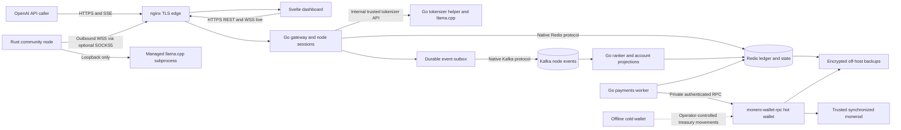

# Cordova — shared architecture and contracts

**Goal:** Deliver a privacy-focused community inference network with an OpenAI-compatible API, accountable routing, and XMR funding and owner payouts.
**Date:** 2026-10-08 (Asia/Baku). **Version:** v1. **Status:** a partial M1/M3 mock implementation exists; see [docs/stage-2.md](docs/stage-2.md), [docs/stage-3.md](docs/stage-3.md), and [docs/verification.md](docs/verification.md) for current scope and evidence. Code presence alone does not pass a milestone gate. The user's updated single-host pilot conditions are recorded in [docs/deployment-pilot.md](docs/deployment-pilot.md).

Apply planiuer guides: Core (scope and dependencies), Security (untrusted nodes and custodial money), Quality (three implementation languages), First-Run (protocol, tokenizer, persistence and wallet verification). Skip none. The request for exactly four files overrides the skill's single-document output: this file owns all shared decisions and contracts; the other three own implementation tasks. Preserve `.old/`; its school-platform plans are unrelated.

## Summary

Build User → Go Server → Rust Nodes; use Svelte/TypeScript for the account dashboard.
Use TLS WebSockets for nodes, HTTPS/OpenAI SSE for callers, and REST/WebSockets for the dashboard.
Use Redis for durable state and the ledger, Kafka for node events, nginx for TLS, and isolated Monero wallet RPC for payments.
Manage llama.cpp as a subprocess; perform authoritative tokenization in a trusted server-side helper.
Treat plaintext disclosure to community nodes and loss or duplication of money as the largest risks.
Start with M0 contract and failure spikes, then M1's complete mock-node vertical slice.
Stop real-money rollout if ledger recovery, payout ambiguity handling, tokenizer parity, or privacy tests fail.

## Core 1 — Functionality and scope

| Capability | Primary user | v1 result |
| --- | --- | --- |
| Fund an account with XMR | API consumer | Unique subaddress, confirmation progress, spendable balance and immutable history |
| Submit chat requests | API consumer | Named catalog model, reservation, capacity routing, streamed or complete response, authoritative usage and settlement |
| Manage API keys | Account holder | Create once-visible secrets; scope by model, permission and daily spend; revoke and inspect last use |
| Contribute inference capacity | Node owner | CLI enrollment, authenticated reconnect, automatic model management and graceful shutdown |
| Inspect nodes and earnings | Node owner | Reported hardware, tested capacity, rank, availability, earnings, holds and payout history |
| Pay owners | Node owner | Mature earnings paid in batches to a validated XMR address |
| Observe operations | Operator | Content-free metrics, financial reconciliation, tested restore and emergency payment/inference stops |

Exclude tools/function calls, multimodal messages, embeddings, arbitrary user-supplied models, fine-tuning, prompt caching across requests, public node inbound ports, peer-to-peer inference, fiat conversion and user-to-user transfers from v1. “Mesh” describes community capacity: the server is a centralized routing and billing coordinator. Implement the specified chat subset faithfully; return a documented validation error for unsupported parameters.

## Core 2 — Stack and architecture

| Layer | Decision and reason | Rejected alternative | Constraint |
| --- | --- | --- | --- |
| Gateway and workers | Go; shared domain packages with independently runnable worker commands | Rust gateway: violates mandatory Go server and adds implementation coupling | Supported Go stable release, pinned patch in M0; `net/http`, checked integer arithmetic |
| Community node | Rust, Tokio, rustls WebSockets and managed llama.cpp `llama-server` child | Direct FFI: ABI churn and unsafe memory boundaries complicate portable releases and crash recovery | Pin one llama.cpp commit for node and trusted tokenizer; forbid unsafe in application crates |
| Trusted tokenizer | Internal llama.cpp subprocess supervised by a Go helper | Node-supplied counts or generic tokenizer approximations: cannot establish billing truth | Admit only catalog models whose template, vocabulary and BOS behavior pass parity tests |
| Dashboard | Svelte 5, SvelteKit 2 static adapter, TypeScript strict, Vite | React: unnecessary and violates Svelte requirement | Node.js 24 LTS baseline; pin mutually compatible patches and npm lockfile in M0 |
| Durable store | Redis, standalone primary; production adds a replica with AOF | Redis Cluster: cross-account Lua transactions would cross slots | Redis release with `WAITAOF` (minimum 7.2); choose a maintained, audited patch and image digest in M0 |
| Events | Apache Kafka 4.x in KRaft mode; Go franz-go client | Redis as the ranking event bus: violates required Kafka boundary | Broker/client compatibility verified in M0; native protocol only |
| Edge | nginx, maintained stable release | Application-managed public TLS: complicates a single edge policy | TLS 1.2/1.3; WS upgrades and unbuffered SSE |
| Payments | Monero wallet RPC plus a synchronized trusted `monerod` | Public third-party wallet API: custody and privacy exposure | Pin release/checksum; stagenet until M6 gates pass |
| CI and deployment | GitHub Actions, Compose v2, immutable OCI images | Kubernetes: exceeds v1 operational scope | Production is a supervised host deployment; no automatic financial failover |

Version selection is an M0 deliverable, not permission to use floating `latest`. Record versions, licenses, digests, signatures and verified external API samples in `contracts/versions.lock.json` and `docs/verification.md` during implementation. Use maintained patches that pass the gates; do not claim untested compatibility.



Boundary rules: only nginx is public. Nodes initiate outbound connections. Redis/Kafka are private native-protocol services, never wrapped in WS. Community nodes never receive API keys, account balances, deposit addresses or wallet access. Treat the trusted tokenizer as part of the server privacy boundary, with the same no-content logging and disk rules.

### Repository ownership

```text
contracts/                 # Backend owns OpenAPI, JSON Schema, generated fixtures and version lock
server/                    # Backend owns Go gateway, tokenizer helper, workers and Lua scripts
node/                      # Backend owns Rust workspace and llama.cpp integration
frontend/                  # Frontend owns Svelte app and generated client consumption
infra/                     # Infra owns Compose, nginx, persistence, monitoring and release manifests
scripts/                   # Infra owns root command orchestration; backend/front supply their checks
tests/system/              # Backend owns cross-service scenarios; front owns browser specs
docs/                      # Each agent owns its setup/runbook pages; shared decisions remain here
.github/workflows/         # Infra owns CI and release pipelines
```

## Core 3 — Dependency-ordered milestones

Commands below are acceptance commands. Their current implementation and evidence are recorded in `docs/verification.md`; code presence alone does not pass a gate. S/M/L indicate relative work size. Each row is a task with its own executable gate; per-agent decomposition lives in the linked plan.

| Task | Imperative deliverable | Dependencies / parallelism | Size | Done when |
| --- | --- | --- | --- | --- |
| M0 — Verify contracts and failure assumptions | Generate contract schemas; pin tools; capture real tokenizer, WS, Redis precision/durability and stagenet wallet samples | First; backend and infra spikes can run in parallel; frontend begins after DTO publication | M, highest risk | **Done when:** `make verify-foundations` passes money values above 2^53, template/token parity, wallet prepare/relay failure cases and native private connectivity; `make contracts-check` passes |
| M1 — Build a complete mock-node slice | Run nginx → Go → mock WSS node → SSE, persist a metadata event, consume Kafka, show a dashboard account | M0; frontend shell and infra stack parallel with backend adapters | M | **Done when:** `make smoke` in a clean clone returns a models list, one SSE completion ending `[DONE]`, and the same usage metadata in the dashboard; only test credits exist |
| M2 — Integrate the real node and capacity routing | Ship login, model verification/load, real inference, authoritative tokenization, lease-safe routing and proxies | M1; portable builds and frontend node views parallel | L | **Done when:** `make test-node-routing` proves all five routing priorities, bounded concurrency, real model parity, reconnect fencing and Linux/Windows/macOS smoke |
| M3 — Complete request accounting and failure recovery | Implement atomic append-only ledger, reservations, settlement, cancellation, retry, restart recovery and spend caps | M1; proceed against mock nodes in parallel with M2; final gate requires M2 | L | **Done when:** `make test-ledger-recovery` proves conserved money, one terminal settlement, zero leaked reservations and every failure scenario in §Ledger |
| M4A — Verify rank and fraud controls | Consume events, compute rank, issue benchmarks/canaries, run sampled comparisons and payout holds | M2 and M3; parallel with M4B | M | **Done when:** `make test-rank-fraud` reproduces deterministic rank, duplicate/out-of-order handling, invalid count flags and held earnings |
| M4B — Integrate XMR deposits and payouts | Run confirmed deposit watcher, held earnings maturity, prepared payout batches and reconciliation | M3; parallel with M4A | L | **Done when:** `make test-payments-stagenet` funds a unique subaddress, credits once, relays one stored batch and reconciles after RPC/restart faults |
| M5 — Complete dashboard and release operations | Finish all pages, accessibility, binary releases, recovery runbooks, backups and monitoring | M2/M3; page work starts earlier from contracts; final acceptance after M4A/M4B | L | **Done when:** `make test-product` passes browser workflows and `make restore-drill` verifies off-host restore; every supported binary passes login/run/shutdown |
| M6 — Qualify the capped production pilot | Run adversarial tests, load qualification, external security review, jurisdiction review and production restore drill | M4A, M4B, M5; load and security review parallel | M | **Done when:** `make release-gate` passes; an operator follows the deployment and recovery runbooks without undocumented steps; mainnet stays disabled until all gates pass |

Critical path: M0 → M1 → M2/M3 → M4A/M4B → M5 → M6. Individual agents may implement their contract-based branches in parallel; do not create additional agents as part of writing these plans. Use [PLAN-front.md](PLAN-front.md), [PLAN-back.md](PLAN-back.md), and [PLAN-infra.md](PLAN-infra.md) as ownership queues.

## Core 4 — Assumptions and caveats

Record these decisions as executable defaults. Agents must proceed without clarification; changes require a versioned update here and regenerated contracts.

| ID | Assumption / decision |
| --- | --- |
| A01 | Launch one region, one gateway process and one payment writer; bounded pilot of 100 connected nodes, 20 concurrent inference requests and 1,000 accounts. Horizontal gateway handoff is deferred. |
| A02 | Use random UUIDv4 identifiers. All timestamps are UTC RFC3339; all prices/balances are decimal strings representing integer piconero. 1 XMR = 10^12 piconero. |
| A03 | Start with `cordova-chat-small-v1`, an operator-converted GGUF of Qwen2.5-1.5B-Instruct, Q4_K_M, context 8,192, output limit 2,048. M0 must verify redistribution license, artifact hashes and token/template behavior before admitting it. Support additional catalog models without changing wire v1. |
| A04 | Initial configurable rates are 10,000,000,000 piconero per 1M input tokens and 20,000,000,000 per 1M output tokens; owner share 8,000 basis points. They are test/pilot defaults, not a market-rate assertion. |
| A05 | Use single-region custody and operator-controlled cold storage. Minimum owner payout is 10,000,000,000 piconero (0.01 XMR); fees are paid from platform equity, not silently deducted from owner principal. |
| A06 | Apply 10 deposit confirmations plus wallet spendability checks; hold all owner earnings 24 hours, flagged earnings at least 7 days and until reviewed. Batch every 6 hours UTC. |
| A07 | Use username/password accounts, Argon2id password hashes, cookie sessions and TOTP step-up for payouts. Avoid mandatory email/phone collection. Issue one-time recovery codes; no unauthenticated password-reset bypass. |
| A08 | Default key limits: 60 requests/minute, two concurrent requests and 100,000,000,000 piconero/day. Account default: ten concurrent requests and 1,000,000,000,000/day. Reservation consumes limits atomically. |
| A09 | Retry a failed node once on another eligible node only before any completion content is delivered. After SSE content starts, refund in full and terminate with the specified SSE error. This is an explicit exception to unconditional retry: OpenAI SSE cannot retract a prior attempt. Nonstreamed responses may retry while all text remains private in memory. |
| A10 | Client cancellation is distinct from node failure: charge verified text already accepted for delivery, release the remainder and disclose this rule. Infrastructure/node failures receive full refunds, including partial streams. |
| A11 | Select 1% of eligible user requests at dispatch for a concurrent duplicate to a different owner, funded by the platform; disclose that two nodes may receive content. Compare successful outputs within the original request's memory lifetime; cancel/discard unfinished shadows at logical termination. Eligibility requires an available independent owner and enough capacity. Measure skipped samples; canaries remain mandatory. |
| A12 | Treat “verified VRAM” as a lower bound on capacity demonstrated by load/concurrency challenges. GPU identity and exact free/total VRAM remain self-reported; consumer hardware cannot supply remote attestation. |
| A13 | Production ledger acknowledgement requires local and replica AOF fsync; dev requires local fsync. Never promote an unverified replica automatically or continue billing during storage uncertainty. |
| A14 | Nodes support outbound SOCKS5h proxies, including Tor, with proxy DNS and fail-closed connectivity. Tor does not hide prompt content from nodes or identity from logged-in server accounts. |
| A15 | Keep financial audit and idempotency tombstones five years, detailed request metadata 30 days and content-free operational logs seven days; proposed retention needs jurisdiction review before mainnet. Never retain prompt/response hashes except keyed request-identity digests as specified below. |
| A16 | Use English docs/UI, WCAG 2.2 AA, desktop/mobile browsers; CPU fallback is functional but eligibility still requires passing a model's latency/throughput benchmark. |
| A17 | Bind dev nginx to localhost with a generated local CA; production domain comes from `PUBLIC_ORIGIN` and certificates from infra secrets. Stagenet is the default and no real payments occur in CI. |
| A18 | Backups and fail-closed recovery, not uninterrupted service, are the v1 availability strategy. Production target: restore within four hours and off-host backup recovery point ≤15 minutes; pause money movement and reconcile possible newer on-chain payments after restore. |
| A19 | Cap verification spend at 5% of gross inference revenue per UTC day; before revenue exists use an operator-funded seed budget of 1,000,000,000 piconero/day. Zero budget/capacity skips user shadows and raises coverage metrics; synthetic canaries remain a required funded operation and an unfunded canary schedule blocks production admission. |

Kill criteria: block real-money operation if output pricing exceeds reservations, an accepted financial event disappears in power-loss tests, payout fault injection creates two payments, privacy sentinels reach disk/logs, a model's license fails review, or the server cannot independently tokenize it. Stop expansion beyond A01 when the load gate fails; optimize only after measuring.

## Core 5 — User decisions

No question is pending. All defaults, including costly-to-reverse choices, are collected in the decision log near the end. Independent agents execute those defaults and record verified deviations through a PLAN version change. Deployment personnel still supply actual domains, credentials, treasury addresses and off-host backup destinations through secret/configuration channels, never invented public values.

## Shared contract C1 — Types, validation and catalog

This section is authoritative for all agents. Backend creates `contracts/openapi.yaml` (OpenAPI 3.1) and `contracts/ws/v1.schema.json` (JSON Schema 2020-12); derive Go, Rust and TypeScript types and positive/negative fixtures from these contracts. Generated sources are committed with a generation check. Do not hand-maintain alternate DTOs. An incompatible wire change increments `v`; additive fields require schema/default and fixture updates before use.

Common primitives: `Id` is UUIDv4; `Money` is a canonical base-10 string matching `0|[1-9][0-9]*`, capped at 9,000,000,000,000,000,000; signed ledger postings additionally allow a leading `-` except `-0`. Reject floats, exponent notation and numeric JSON money. `Hash` is lowercase 64-character SHA-256 hex. Token counts and byte counts are bounded nonnegative integers; ranks 0–100. Use checked Go `int64` balances and `big.Int` intermediates; TypeScript `bigint`; Rust checked integers. Lua uses decimal-string comparison/add/subtract helpers, never floating-point conversion of money.

Reject unknown fields in Cordova REST/WS payloads. In `/v1/chat/completions`, reject unsupported nonempty parameters with `400 unsupported_parameter`; permit only explicitly documented harmless SDK metadata (`user` is accepted then discarded). Limit HTTP bodies to 1 MiB, messages to 128, each text field to 256 KiB and response text to 1 MiB. Validate UTF-8, bounds, ownership and enum variants before work. Never log rejected bodies.

| DTO | Exact required fields; `?` means optional, `null` explicitly nullable |
| --- | --- |
| `Account` | `id`, `username` (3–64 chars), `created_at`, `totp_enabled` bool, `privacy_notice_version` string |
| `SessionView` | `account:Account`, `csrf_token` string, `expires_at` |
| `Model` | `id` slug, `object:"model"`, `created` Unix seconds, `owned_by:"cordova"`, `context_tokens`, `max_output_tokens`, `availability:ready|warming|unavailable`, `input_rate_piconero_per_million:Money`, `output_rate_piconero_per_million:Money`, `owner_share_bps` integer 0–10,000, `price_version` Id |
| `CatalogManifest` (internal/signed) | `model:ModelDefinition`, `artifact_url` HTTPS, `artifact_sha256:Hash`, `artifact_size_bytes`, `tokenizer_sha256:Hash`, `template_sha256:Hash`, `llama_commit` string, `add_bos` bool, `min_memory_bytes`, `memory_per_slot_bytes`, `license_spdx`, `version` Id, `signature` base64 Ed25519 over canonical JSON excluding signature; economic snapshot uses nested model fields |
| `ApiKey` | `id`, `name` ≤64 chars, `prefix`, `permissions` subset of `chat:write,models:read,usage:read`, `model_ids` nonempty slug array, `daily_spend_cap_piconero:Money`, `created_at`, `last_used_at` timestamp/null, `revoked_at` timestamp/null |
| `Hardware` | `platform:linux|windows|macos`, `arch:x86_64|aarch64`, `backend:cuda|metal|vulkan|cpu`, `gpu_name` string/null, `reported_total_vram_bytes`, `reported_free_vram_bytes`, `ram_bytes`; no serial numbers |
| `NodeModel` | `model_id`, `state:loaded|on_disk|absent|downloading|loading|failed`, `active_slots`, `max_slots`, `verified_capacity_bytes`, `updated_at` |
| `Node` | `id`, `name`, `status:enrolling|benchmarking|online|busy|warming|offline|draining|quarantined`, `rank:int|null`, `rank_updated_at` timestamp/null, `hardware:Hardware|null`, `verified_capacity_bytes:uint64|null`, `measured_tokens_per_second:number|null`, `latency_ms:uint64|null`, `uptime_ratio:number|null`, `success_ratio:number|null`, `last_seen_at` timestamp/null, `models:NodeModel[]`, `earnings_pending_piconero:Money|null`, `earnings_available_piconero:Money|null`, `hold_until` timestamp/null. Use null until the corresponding trusted measurement, rank or ledger projection exists; never substitute zero for unavailable data. Hardware remains explicitly self-reported until verified. |
| `Balance` | `available_piconero`, `reserved_piconero`, `earnings_pending_piconero`, `earnings_available_piconero`, `payout_reserved_piconero`, `currency:"XMR"`, `updated_at`; every balance field is `Money` |
| `DepositAddress` | `address`, `network:stagenet|mainnet`, `confirmations_required`, `uri` (Monero payment URI, no embedded amount), `created_at` |
| `Deposit` | `id`, `txid:Hash`, `amount_piconero:Money`, `confirmations`, `status:pending|credited|reversed|locked`, `observed_at`, `credited_at` timestamp/null |
| `LedgerView` | `id`, `kind`, `request_id` Id/null, `amount_piconero` signed decimal string relative to account, `balance_after_piconero:Money`, `created_at`, `reference_id` string; never another account's IDs |
| `PayoutSettings` | `address` string/null, `network`, `minimum_piconero:Money`, `changed_at` timestamp/null, `eligible_after` timestamp/null |
| `Payout` | `id`, `amount_piconero:Money`, `status:queued|prepared|relaying|broadcast|confirmed|unknown|failed`, `txids:Hash[]`, `created_at`, `updated_at`, `hold_reason` enum/null |
| `UsageRow` | `request_id`, `model_id`, `status:accepted|running|settled|refunded|cancelled|recovering`, `input_tokens`, `output_tokens`, `charged_piconero:Money|null` (null only while recovering), `latency_ms` integer/null, `created_at`, `finished_at` timestamp/null |
| `Analytics` | `from`, `to`, `bucket:hour|day`, `buckets:[{start,requests,input_tokens,output_tokens,spend_piconero:Money,p50_latency_ms:null|integer,p95_latency_ms:null|integer,successes,failures}]` |

`ModelDefinition` is `Model` with `availability` omitted: signed manifests contain immutable catalog/economic fields; the gateway adds current availability when producing the public Model DTO. `Page<T>` is `{data:T[],next_cursor:string|null}` ordered newest first with a signed opaque cursor. Default limit 50, maximum 100. `from/to` are UTC timestamps, maximum analytics span 30 days. Null means unavailable, never silently zero. Account DTOs omit HWID hashes, node secrets, fraud details and other owners' identifiers.

## Shared contract C2 — REST, auth and OpenAI API

Public edge paths below are exact. Browser APIs use HttpOnly `__Host-cordova_session`, Secure, SameSite=Lax, Path=/, no Domain; idle expiry 12 hours, absolute expiry seven days. Return CSRF token through session JSON; require `X-CSRF-Token` and matching Origin for authenticated mutations. Require same-origin WS upgrades. Set `Cache-Control: no-store` on private APIs. API keys use `Authorization: Bearer cvk_<random-secret>` and are not cookie-authenticated. Store only HMAC-SHA-256 key verifier with external pepper, display the secret once, compare in constant time and check revocation/scopes on every request.

REST errors use `{error:{message:string,type:string,param:string|null,code:string},request_id:Id}`. Types are `invalid_request_error`, `authentication_error`, `permission_error`, `rate_limit_error`, `server_error`. Messages are safe fixed descriptions. Codes: `invalid_request`, `unsupported_parameter`, `unauthenticated`, `forbidden`, `csrf_failed`, `not_found`, `conflict`, `insufficient_funds`, `spend_cap_exceeded`, `rate_limited`, `model_not_found`, `model_warming`, `no_capacity`, `node_failed`, `timeout`, `storage_unavailable`, `tokenizer_unavailable`, `wallet_unavailable`, `replay_unavailable`, `verification_required`, `enrollment_pending`. Map validation to 400, auth to 401, authorization to 403, unknown resource/model to 404, conflicts/replay to 409, enrollment pending to 428, financial/rate limits to 429 and temporary infrastructure/capacity failures to 503. Capacity failures never use 403; include integer `Retry-After` seconds (default 5 for warming, 2 for capacity).

| Method/path | Auth and exact request | Response / behavior |
| --- | --- | --- |
| `POST /api/auth/register` | Public; `{username,password,privacy_notice_version}`; password 12–128 chars; auth throttle | 201 `SessionView`; server generates recovery codes once in an additional `recovery_codes:string[]` field |
| `POST /api/auth/login` | Public; `{username,password,totp_code?:string}` | 200 `SessionView`; generic 401 for invalid credentials; rotate session |
| `POST /api/auth/recover` | Public; `{username,recovery_code,new_password}` | 200 `SessionView`; consume recovery code once, revoke existing sessions, reset TOTP for re-enrollment and lock payouts for 24h |
| `GET /api/session` | Session | 200 `SessionView`; 401 when expired |
| `POST /api/auth/logout` | Session + CSRF; `{}` | 204; revoke current session and its live socket |
| `POST /api/auth/totp/setup` | Session + CSRF + `{password,totp_code?:string}`; require current TOTP if already enabled | 200 `{setup_id,otpauth_uri,expires_at}`; expires in 10min; no password-only replacement of an enabled TOTP seed |
| `POST /api/auth/totp/confirm` | Session + CSRF; `{setup_id,code}` | 204; activate only after validating current TOTP |
| `POST /api/auth/step-up` | Session + CSRF; `{password,totp_code}` | 200 `{step_up_token,expires_at}`; bound to session, single use, five-minute lifetime |
| `GET /api/keys` | Session | `Page<ApiKey>` |
| `POST /api/keys` | Session + CSRF; `{name,permissions,model_ids,daily_spend_cap_piconero}` | 201 `{key:ApiKey,secret:string}`; require privacy notice acknowledged |
| `DELETE /api/keys/{id}` | Session + CSRF | 204 idempotent; cancel active requests for this key using cancellation policy |
| `GET /api/nodes` / `GET /api/nodes/{id}` | Session, own nodes only | `Page<Node>` / `Node`; owner mismatch returns 404 |
| `POST /api/nodes/link` | Session + CSRF; `{user_code,name}` | 201 `Node`; atomically approve exactly one pending enrollment |
| `PATCH /api/nodes/{id}` | Session + CSRF; `{name}` | 200 `Node` |
| `POST /api/nodes/{id}/revoke` | Session + CSRF; `{}` | 204; revoke secret version/tokens, fence socket, fail active node attempts |
| `POST /api/node/enrollments` | Public; `{hwid_hash:Hash,node_version,device_name}` | 201 `{enrollment_id,user_code,device_code,verification_uri,expires_at,poll_interval_seconds:5}`; codes expire in 10min; device code ≥256 random bits |
| `POST /api/node/enrollments/token` | Device secret; `{device_code}` | 428 `enrollment_pending` until linked; 200 `{node_id,node_secret,server_origin}` after approval; same response may be re-read for 10min with same device secret, then wipe encrypted enrollment secret |
| `POST /api/node/auth/challenge` | Public; `{node_id}`; rate-limited | 200 `{nonce,expires_at}`; nonce 256 bits, lifetime 60s |
| `POST /api/node/auth/token` | `{node_id,nonce,proof:Hash}` | 200 `{access_token,expires_at}`; protocol below; never a browser session |
| `GET /api/billing/address` | Session | `DepositAddress`; lazy, serialized, idempotent subaddress allocation |
| `GET /api/billing/balance` | Session | `Balance` |
| `GET /api/billing/deposits` / `GET /api/billing/history` | Session + pagination | `Page<Deposit>` / `Page<LedgerView>` |
| `GET /api/billing/payout-settings` | Session | `PayoutSettings` |
| `PUT /api/billing/payout-settings` | Session + CSRF; `{address,step_up_token}` | 200 `PayoutSettings`; validated for configured network; change blocks payout for 24h |
| `GET /api/billing/payouts` | Session | `Page<Payout>`; automatic batches, no manual transfer endpoint |
| `GET /api/usage` | Session or key with `usage:read`; model/date/pagination filters | `Page<UsageRow>`; API keys see only their own requests |
| `GET /api/analytics` | Session; `from,to,bucket` | `Analytics`; 30-day data window |
| `GET /api/requests/{id}` | Session owner or originating key | `UsageRow`; metadata-only recovery/status lookup |
| `POST /api/live-ticket` | Session + CSRF; `{}` | 200 `{ticket,expires_at}`; one use, 30s, session-bound |
| `GET /api/live` (upgrade) | Session cookie + same Origin; WS first-message ticket | See C4; never put a ticket in URL |
| `GET /api/node/ws` (upgrade) | Node signed access token in Authorization header | See C3; reject stale/replayed token before upgrade |
| `GET /v1/models` | API key `models:read`, or browser session for catalog display | `{object:"list",data:Model[]}`; known catalog models include unavailable ones |
| `POST /v1/chat/completions` | API key `chat:write` + permitted model; optional `Idempotency-Key` ≤128 chars | OpenAI responses/SSE below |
| `GET /healthz` | Internal; nginx may expose only generic status | 200 process liveness; no configuration/dependency details |
| `GET /readyz` / `GET /metrics` | Private operator network | Readiness and content-free Prometheus metrics; never public nginx routes |

Throttle auth to five failures/minute per username and source, enrollment to ten/minute per source and 100/day per account approvals. Keep source identifiers as rotating keyed digests with 24h TTL; do not persist raw IP addresses. Registration requires a valid notice version, not a payment. Password recovery uses offline recovery codes; payout step-up always requires TOTP.

### OpenAI chat subset and token accounting

Accept `{model,messages:[{role:"system"|"user"|"assistant",content:string}],max_tokens?:integer,stream?:boolean,stream_options?:{include_usage:boolean},temperature?:number,top_p?:number,stop?:string|string[],seed?:integer,n?:1,user?:string}`. Default `max_tokens=512`, `stream=false`, `temperature=0.7`, `top_p=0.95`; validate temperature 0–2, top_p >0–1, ≤4 stop strings each ≤128 chars. Reject tool messages, array content, logprobs, reasoning extensions and `n!=1`. Require at least one user turn; input count plus requested output must fit the model context. Omitted model/unknown slug returns validation/404 respectively.

Snapshot manifest and price version at acceptance. Apply the pinned chat template in the trusted helper, tokenize with manifest BOS policy and special-token behavior, then send those exact input token IDs to the node's `/completion` endpoint. Do not let nodes re-template or add tokens. Count output by tokenizing the concatenated decoded text with `add_special=false,parse_special=false`; never sum chunk counts. Validate every proposed chunk before forwarding: if its cumulative text breaches max output tokens/bytes, cancel and fail/refund the attempt. Recount at completion. Billing defines completion tokens as tokens of delivered decoded text, excluding hidden reasoning and EOS; only models passing these fixtures are admitted. Helpers keep request data in memory; no tokenizer disk caches.

Full response: `{id:"chatcmpl-<request-id>",object:"chat.completion",created:<unix>,model,choices:[{index:0,message:{role:"assistant",content:<text>},finish_reason:"stop"|"length"}],usage:{prompt_tokens,completion_tokens,total_tokens}}`. Return `X-Request-ID` on every HTTP response. SSE uses `Content-Type:text/event-stream`, `Cache-Control:no-cache`, unbuffered flushing, no response persistence. Send `data: <JSON>\n\n`: initial role chunk, content chunks and final finish chunk with `object:"chat.completion.chunk"`, stable id/created/model and `choices:[{index:0,delta:{role?:"assistant",content?:string},finish_reason:null|"stop"|"length"}]`. If `include_usage`, emit a final chunk with `choices:[]` and authoritative usage; prior chunks have `usage:null`. End success with `data: [DONE]\n\n` only after durable settlement. Send a comment heartbeat `: heartbeat\n\n` every 15s while waiting.

After headers, errors are `data: {"error":{...},"request_id":"..."}\n\n`, followed by close; do not send success finish or `[DONE]`. HTTP status remains 200 because headers were sent. Before headers use normal error status. Defer headers until a node has accepted inference. First content fixes the streaming attempt; never concatenate a retry into that stream. Settlement failures close with `storage_unavailable`; metadata status remains `recovering` until a worker resolves it. Clients query request status rather than assuming an error means money was lost.

Require idempotency across internal retries and all ledger mutations. For client reuse of `Idempotency-Key`, scope by account/key, store its keyed hash and request mapping; while in progress return 409 `conflict`; after terminal return 409 `replay_unavailable` with request ID, since response text is not retained. Reject different bodies for an existing key using a server-HMAC canonical-body digest kept 30 days, then reject reuse without comparing bodies. Never restart a completed logical request or replay content from disk.

## Shared contract C3 — Node WebSocket v1

### Authentication, connection and envelope

Generate an installation salt once; hash a normalized local hardware/OS fingerprint plus salt as HWID. Upload only the hash; a hardware change may update this abuse signal without changing authentication. CLI `cordova-node login` starts enrollment, opens/prints the verification URI and user code, polls and stores the returned secret in the OS credential store (0600 file only as explicitly warned fallback). The owner must link the displayed code in an authenticated dashboard. Then the server issues NODE_ID and a random 256-bit node secret.

For auth, compute `proof = HMAC-SHA256(node_secret, "cordova-node-auth-v1\n" + node_id + "\n" + nonce)` as lowercase hex. Store node secrets encrypted using an external master key. Atomically consume nonce and mint an Ed25519-signed JWT containing `iss`, `aud:"cordova-node-ws"`, `sub:node_id`, `secret_version`, `jti`, `iat`, `exp` (five minutes). Accept only EdDSA with pinned issuer/audience and ≤30s clock skew. Consume jti once at upgrade; maintain a maximum 24h socket lifetime and reauthenticate on reconnect. Revoke secret versions immediately. TLS plus signed token is the selected alternative to mTLS; user API keys cannot authenticate nodes.

All text frames contain exactly one JSON envelope:

```json
{
  "v": 1,
  "type": "inference.delta",
  "message_id": "4e345523-1a8c-4f4b-9d48-0593cf3e7eca",
  "request_id": "706134d8-0590-437c-ab24-bb9c396c815b",
  "session_id": "c9eb01e9-899f-4edb-87fd-66e585ec9f79",
  "seq": 7,
  "sent_at": "2026-10-08T16:00:00Z",
  "payload": {"attempt_id":"b1170ebe-dcd3-475c-bd61-3a4b902ae8af","lease_id":"c386a5ce-18b9-4fa5-9e96-ddb8bdbd1b4a","chunk_index":0,"text":"Hello"},
  "error": null
}
```

All fields are required. `request_id` is nullable only for unsolicited connection/state events; control exchanges get fresh IDs and replies echo them; inference attempts share the logical request ID and carry their own `attempt_id`. `session_id` is null only for initial `hello` (or C4's `live.auth`); `welcome`/`live.ready` carry the allocated session ID in envelope and payload, and every later frame binds it. `seq` starts at 1 per direction per connection, strictly increments, uint32; reconnect resets it with a new session. `message_id` deduplicates acknowledgements repeated with a fresh sequence number but never authorizes inference replay. `error` is null except `error` messages, where it is `{code,message,retryable}` and payload identifies the failing operation. Disable compression; bound frames at 1 MiB, delta text at 16 KiB and in-memory outgoing queue at 32 frames/512 KiB. Reject binary frames and duplicate JSON keys.

### Message payloads (complete v1 type registry)

Notation uses C1 types. Every property below is required unless `?`; reject unknown fields. `S→N` and `N→S` are the only permitted directions.

| Type / direction | Payload and behavior |
| --- | --- |
| `hello` N→S | `{node_id,node_version,protocol_versions:[1],hardware:Hardware,hwid_hash:Hash}`; first frame within 5s; node ID must equal token subject |
| `welcome` S→N | `{session_id,heartbeat_interval_ms:15000,heartbeat_timeout_ms:45000,catalog_version:Id,max_frame_bytes:1048576,connection_expires_at}`; store fenced session before reply |
| `heartbeat` N→S | `{active_leases:Id[],hardware:Hardware,models:NodeModel[]}` every 15s; reports are advisory, active slots are computed from server leases |
| `heartbeat.ack` S→N | `{server_time,session_expires_at}`; echoes heartbeat request ID when nonnull |
| `catalog.get` N→S | `{known_version:Id|null}` |
| `catalog.snapshot` S→N | `{version:Id,models:CatalogManifest[]}`; verify each manifest signature/hash; no arbitrary artifact URLs accepted |
| `model.query` S→N | `{model_id,catalog_version}`; wire representation of `has_model?` |
| `model.state` N→S | `{model_id,state:"loaded"|"on_disk"|"absent",artifact_sha256:Hash|null,active_slots,max_slots,reason_code:string|null}`; loading/downloading reports `absent` with reason; three-way handshake result |
| `model.load` S→N | `{model_id,catalog_version,command_id:Id,deadline_at}`; only signed catalog artifacts |
| `model.download` S→N | `{model_id,catalog_version,command_id:Id,deadline_at}`; background download then load; never serves the triggering request |
| `model.accepted` N→S | `{model_id,command_id,operation:"load"|"download"}`; deduplicate command ID across reconnect |
| `model.progress` N→S | `{model_id,command_id,phase:"downloading"|"verifying"|"loading",completed_bytes,total_bytes}`; throttle to once/s |
| `model.ready` N→S | `{model_id,command_id,artifact_sha256,tokenizer_sha256,template_sha256,max_slots,verified_capacity_bytes}`; server verifies catalog equality before eligibility |
| `model.reject` N→S | `{model_id,command_id:Id|null,code:"insufficient_memory"|"disk_full"|"unsupported_backend"|"catalog_mismatch"|"download_failed"|"load_timeout"|"busy",retryable:bool}`; no shell paths or raw subprocess errors |
| `inference.start` S→N | `{attempt_id,lease_id,model_id,catalog_version,input_token_ids:integer[],input_tokens,max_tokens,parameters:{temperature,top_p,stop:string[],seed:integer|null},deadline_at,kind:"user"|"shadow"}`; token IDs bounded by vocabulary and input count; no account identifiers |
| `inference.accepted` N→S | `{attempt_id,lease_id}` within 2s; refuse if matching model/version/slot unavailable |
| `inference.delta` N→S | `{attempt_id,lease_id,chunk_index,text}`; indices start 0 and increase by one; no replay after reconnect |
| `inference.complete` N→S | `{attempt_id,lease_id,last_chunk_index:integer|null,finish_reason:"stop"|"length",claimed_input_tokens,claimed_output_tokens}`; claims are diagnostic only |
| `inference.cancel` S→N | `{attempt_id,lease_id,reason:"client_cancelled"|"deadline"|"node_revoked"|"output_limit"|"server_shutdown"|"superseded"}` |
| `inference.cancelled` N→S | `{attempt_id,lease_id}`; release local slot; cancel acknowledgement is not financial authority |
| `benchmark.start` S→N | `{benchmark_id,model_id,catalog_version,input_token_ids,max_tokens:256,seed,required_concurrency,leases:[{slot_index,lease_id}],deadline_at}`; leases count equals concurrency, slot indices start 0; fixed synthetic prompt/concurrent capacity challenge, never user content |
| `benchmark.delta` N→S | `{benchmark_id,slot_index,lease_id,chunk_index,text}`; independently ordered chunks per slot; same size validation as inference; server times arrival and tokenizes each slot's concatenated output |
| `benchmark.result` N→S | `{benchmark_id,slots:[{slot_index,lease_id,claimed_output_tokens,finish_reason:"stop"|"length"}],reported_peak_vram_bytes,completed_slots}`; completed slots must match observed successful lease streams; claims cannot establish rank alone |
| `drain` S→N | `{deadline_at,reason:"maintenance"|"revoked"|"upgrade"}`; stop accepting work and finish/cancel leases |
| `drain.ack` N→S | `{active_leases:Id[]}` |
| `goodbye` N→S | `{reason:"shutdown"|"upgrade",active_leases:Id[]}`; server emits leave event and fences session |
| `error` Both | `{operation_type,attempt_id:Id|null,lease_id:Id|null,command_id:Id|null}` plus nonnull envelope error; terminate failed exchange, ignore safely stale frames, never leak native error text |

WS error codes: `unsupported_version`, `invalid_message`, `unauthenticated`, `replayed_message`, `stale_session`, `stale_lease`, `model_not_found`, `catalog_mismatch`, `insufficient_memory`, `no_capacity`, `download_failed`, `load_timeout`, `inference_failed`, `timeout`, `cancelled`, `output_limit`, `rate_limited`, `internal_error`. `retryable=true` is advisory; server decides within A09. Close 1002 for invalid protocol/version, 1009 for oversize, 1008 for policy violation, 4001 for auth expiry/revocation and 1011 for internal failure. Send safe `error` before close when possible.

Receive timeout 45s; application heartbeat plus WS ping/pong detects half-open sockets. Reconnect with full jitter in `[0,min(60s,1s*2^attempt)]`, reset after 60s healthy connectivity, honor 503 `Retry-After`, cap enrollment polling at its published interval. New session atomically invalidates the previous session and all its active attempts. Never resume generation across reconnect; only idempotent model-management commands may resume. Graceful shutdown drains for up to 30s, then cancels and kills the process group.

## Shared contract C4 — Dashboard live WebSocket

Reuse the C3 envelope and sequence rules, with a separate direction/type registry. Connect to `/api/live`, then send `live.auth` with `{ticket}` within 5s using `session_id:null`. Server validates same-origin cookie and consumes ticket, replies `live.ready` with `{session_id,account_id,heartbeat_interval_ms:15000}`. Reject all node messages on this socket. Authenticate again on reconnect; logout/expiry closes 4001 immediately.

| Type / direction | Payload |
| --- | --- |
| `live.subscribe` Front→Server | `{topics:["nodes","usage","billing"],last_event_id:string|null}`; only own account, no caller-selected account IDs |
| `live.event` Server→Front | `{event_id:string,topic:"nodes"|"usage"|"billing",resource_id:Id,revision:integer,action:"invalidate"}`; metadata invalidation only; fetch REST authoritative resource |
| `live.resync` Server→Front | `{reason:"cursor_expired"|"gap"|"slow_consumer"}`; discard cached snapshots and refetch |
| `live.ping` Both / `live.pong` Both | `{time}`; 15s heartbeat, 45s stale detection |
| `error` Both | Same safe envelope error with `{operation_type,attempt_id:null,lease_id:null,command_id:null}` |

Retain per-account invalidation events 24h, cap at 10,000 events; replay after last event ID if present. Deliver at least once. Dedupe by event ID and revision; revision is monotonic per resource. Return resync on expired cursor or overflow. WS events contain no prompts, outputs, secrets, exact balances or payment addresses. Debounce invalidated resource fetches 250ms. Poll snapshots every 30s when WS is unavailable; emit no financial mutations from WS handlers.

## Shared contract C5 — Ledger and request lifecycle

### Money and conservation

For input tokens `I`, output tokens `O`, maximum output `M`, rates `Ri/Ro` and share `S` basis points, snapshot prices and compute with integer ceiling division:

```text
input_cost    = ceil(I * Ri / 1_000_000)
output_cost   = ceil(O * Ro / 1_000_000)
reservation   = input_cost + ceil(M * Ro / 1_000_000)
actual_cost   = input_cost + output_cost
owner_credit  = floor(actual_cost * S / 10_000)
platform_take = actual_cost - owner_credit
refund        = reservation - actual_cost
```

Require `0 <= O <= M`, `0 <= actual_cost <= reservation`; reject overflow before reserving. Every transaction has balanced signed postings summing to zero. Account buckets: `user.available`, `user.reserved`, `owner.pending`, `owner.available`, `owner.payout_reserved`; platform buckets: `equity`, `cash.hot`, `cash.cold`, `cash.in_transit`, `verification_expense`, `network_fee_expense`, `chain_loss_expense`. Use debit-positive assets/expenses and credit-negative liabilities/equity in the journal. Expose liability balances as positive magnitudes in user DTOs; validate their nonnegative magnitudes independently of signed postings.

| Transaction | Exact signed posting deltas (unmentioned buckets unchanged) |
| --- | --- |
| Deposit `D` | `cash.hot +D`, `user.available -D` |
| Reserve `R` | `user.available +R`, `user.reserved -R` |
| Settle reservation `R`, cost `C`, owner share `N` | `user.reserved +R`, `user.available -(R-C)`, `owner.pending -N`, `equity -(C-N)` |
| Full refund `R` | `user.reserved +R`, `user.available -R` |
| Mature earnings `N` | `owner.pending +N`, `owner.available -N` |
| Place attributable unwithdrawn earnings on hold `N` | `owner.available +N`, `owner.pending -N`; affected lots acquire extended maturity/hold |
| Reserve owner payout `P` | `owner.available +P`, `owner.payout_reserved -P` |
| Broadcast payout `P` with fee `F` | `owner.payout_reserved +P`, `cash.hot -(P+F)`, `network_fee_expense +F`; pending chain adjustment reconciles wallet observation timing |
| Pay verified shadow work `V` | `verification_expense +V`, `owner.pending -V` |
| Reorg removes deposit `D`, of which `A` remains available | `cash.hot -D`, `user.available +A`, `chain_loss_expense +(D-A)`; freeze affected account and audit deficit `D-A` without adding spendable credit |

Expense buckets accumulate debits and reduce net platform equity in the reconciliation equation; operator capital funding posts `cash.hot +F,equity -F`. Treasury movements transfer assets via `cash.in_transit` and record fees separately. Reorg recovery or restitution is an explicit reversing/adjusting entry, never a snapshot overwrite.

Reserve moves available → reserved. Successful settlement moves reserved → user available refund, owner pending credit and platform equity. Failed attempts produce no owner credit; full refund moves reserved → available. Shadow/canary work is funded from platform verification expense/equity, never from user reservations, and credited only for successful verified work: `V` is the normal `owner_credit` under that model's price/share snapshot, without creating artificial platform revenue. Maturity moves owner pending → owner available after hold checks. Never edit a historical transaction; reversal/adjustment is a new balanced entry referencing the original.

Store transaction record `{ledger_id,operation_id,kind,request_id:null|Id,attempt_id:null|Id,price_version:null|Id,created_at,postings:[{bucket,account_id:null|Id,delta_piconero:signed-string}],reference_id,previous_hash,entry_hash}` in append-only Redis Stream. Canonicalize and hash entries in a serialized writer order. Hash-chain plus encrypted immutable off-host archives provides tamper evidence; it does not prevent an operator with full custody access from stealing funds. No prompts, generated text, raw keys or raw request body in ledger/outbox.

### Atomicity, idempotency and durability

Implement narrow Lua scripts for reserve, attempt refund, terminal refund, settle, maturity, deposit credit/reversal and payout transitions. A script validates key types, expected state/revision, all arithmetic, caps and postings before its first write; Redis script atomicity does not roll back earlier writes after a runtime error. Precompute balanced entries in Go, then independently verify totals/deltas using Lua decimal-string helpers. Append audit, update balances, operation tombstone and financial outbox in the same successful script. `operation_id` is immutable and unique (`reserve:<request>:<attempt>`, `refund:<request>:<attempt>`, `settle:<request>`, `deposit:<deposit>:<generation>`, `payout:<batch>:<transition>`). Same operation returns the original result without modifying balances. A retry gets a new attempt/reserve operation ID while sharing the request ID; different terminal operations compete through an expected-state compare-and-set, and exactly one wins.

Use a dedicated Redis connection for each financial mutation and subsequent `WAITAOF 1 1 3000` in production, `WAITAOF 1 0 3000` in dev. Check returned fsync counts; never interpret timeout as rollback. Before node dispatch, acknowledge reservation durability. Before success/`[DONE]`, acknowledge settlement durability. On timeout record/return uncertain status, trip a global billing circuit and retry only the same operation after reading its tombstone. A gateway crash leaves enough metadata to refund rather than rerun prompts. Do not automatically promote a replica; storage uncertainty blocks new financial requests and payout relay. Redis describes fsync acknowledgement separately from high availability; this gate is a design constraint, not an exactly-once cross-system claim. [Redis WAITAOF](https://redis.io/docs/latest/commands/waitaof/), [Redis scripting](https://redis.io/docs/latest/develop/programmability/eval-intro/).

### State machine and retry boundaries

```text
accepted → reserved(attempt 1) → dispatching → running → settling → settled
                              ↘ failed attempt → refund attempt in full
                                  → reserve(attempt 2) → dispatching → running
                                  → terminal refunded if retry impossible/fails
running → client cancellation → settle verified accepted prefix → cancelled
any uncertain financial operation → recovering → settled/cancelled/refunded
```

`request_id` identifies one logical call; `attempt_id` identifies each of at most two dispatches. Pin the price snapshot across attempts. Fully release the failed reservation before reserving the retry atomically with cap checks; release the old slot lease and exclude the failed node/owner. Failed attempts do not consume final daily spend, but still consume rate-limit/error budgets. If another concurrent spend uses the released funds, return `insufficient_funds` rather than infer without reservation. Never mark the logical call terminal while a permitted retry is pending. Metadata records attempt outcomes and financial operations without storing prompts.

Defaults: node acceptance 2s; model-state query 2s; local load queue 10s; first-token deadline 30s after dispatch; output idle timeout 15s; total inference 120s. Use monotonic server clocks for timing. One bounded queue position per request; deadline includes waiting. Reclaim leases using current session and attempt IDs, not a count supplied by the node. On client disconnect, cancel immediately, settle the accepted verified prefix (zero cost if no output was accepted), and ignore late frames. Node errors/timeouts get a full refund. On process restart no content exists to retry: fence old sessions, refund all orphan reservations idempotently, then restore readiness. Settlement already durably committed remains charged even if the HTTP acknowledgement was lost.

Recovery tests must exercise duplicate start/delta/complete/cancel, settle versus timeout races, crash after Lua/before fsync/before HTTP response, retry plus concurrent spending, disconnected SSE client, quarantined node and Redis fail-stop. Require zero negative user buckets and exactly one terminal logical outcome. Preserve five-year operation tombstones without TTL-driven refund deletion.

## Shared contract C6 — Routing and ranking

Filter candidates by fresh session (<45s heartbeat), catalog/hash equality, successful benchmark within 24h, no quarantine/hold that blocks new work, model capability and server-leased spare slots. Self-reported VRAM/concurrency never authorizes extra slots. Within each priority sort by rank descending, measured first-token latency ascending, node ID ascending; inject randomized tie-breaking among equivalent rank/latency bins to avoid starving peers.

1. Claim an idle verified node already loaded in memory.
2. Claim a busy loaded node with a free verified concurrency slot.
3. Claim a load/queue lease on an idle node with verified on-disk artifact and sufficient tested memory; ask `model.query`, receive `on_disk`, send `model.load`, wait ≤10s, then convert to an inference lease. Stop waiting if deadline/cancellation expires.
4. If no above candidate exists, select up to two capable `absent` nodes, send background `model.download` (then load); release the current reservation and return 503 `model_warming` plus Retry-After. Never serve this request on that asynchronous warmup.
5. If no capable node exists, release reservation and return 503 `no_capacity`. Unknown catalog model returns 404 `model_not_found` before reservation.

The three-way exchange is `model.query` (`has_model?`) → `model.state:loaded|on_disk|absent` → `inference.start` for loaded, `model.load` for on-disk, or `model.download` for absent; node may `model.reject`. Serialize load/download commands per node/model with command IDs. Routing reads rank from Redis but enforces live leases independently of Kafka lag. Lua claim checks active count and session version; a successful claim can never exceed calibrated slots. Model unloading requires zero inference/load leases; model-manager background work may not evict a model with active requests.

Benchmark on first link, every 24h, after model/driver changes and suspicious outcomes. Use fixed, versioned prompts with a per-challenge nonce, 256 maximum output tokens, server-measured elapsed time and increasing concurrency/memory allocation tests. Reserve benchmark slots. Record a demonstrated capacity floor and a safe per-model concurrency limit with 20% memory headroom; do not claim exact VRAM attestation. Disqualify models below 2 verified output tokens/s or above 30s first-token latency in two successive benchmark runs.

Compute rank every minute from the past 24h, with provisional rank 10 until benchmark and ten outcomes. Use score `100 * (0.20*C + 0.30*T + 0.20*U + 0.10*L + 0.20*S)` rounded down, clamp to 0–100. `C=min(tested_capacity_bytes/24GiB,1)`, `T=min(measured_tokens_per_second/100,1)`, `U=connected heartbeat intervals/expected intervals`, `L=clamp(1-p50_server_latency_ms/2000,0,1)`, `S=(successful_attempts+1)/(finished_attempts+2)`. Capacity is also a hard capability filter; score alone does not imply model fit. Assign rank zero to quarantined nodes. Version the formula; use arrival times rather than node clocks. Offline detection bypasses ranker delay.

## Shared contract C7 — Redis schema and Kafka topics

Prefix keys `cv:v1:`; one standalone primary supports cross-account scripts. Never enable eviction of durable keys (`maxmemory-policy noeviction`). Separate ACL users for gateway, billing/payment, ranker, backup and monitoring. Key tags are namespacing only, not a promise of Cluster compatibility.

| Key suffix | Type / stored fields | Retention |
| --- | --- | --- |
| `account:<id>` / `username:<normalized>` | Hash Account + password verifier/recovery-code verifiers; username lookup string | Account lifetime; anonymize on closure subject to audit retention |
| `session:<hashed-id>` / `totp-setup:<id>` | Hash account/CSRF hash/step-up/TOTP ciphertext, expiry | 7d absolute / 10min |
| `key:<id>` / `key-index:<verifier>` / `account-keys:<id>` | Hash ApiKey + HMAC verifier; lookup string; set IDs | Revoked key audit metadata 5y, verifier removed on revoke |
| `enrollment:<hashed-device-code>` / `enrollment-code:<user-code>` | Pending owner link, salted HWID, encrypted issued secret, expiry | 10min; tombstone 24h |
| `node:<id>` / `account-nodes:<id>` | Hash owner, encrypted secret/version, HWID signal, public Node metadata; set IDs | Until deletion; retained payout references anonymized |
| `node-session:<id>` | Current session/generation/gateway ID and last heartbeat | 45s refresh; durable node status separate |
| `node-auth-nonce:<hash>` / `node-auth-jti:<hash>` | One-use auth records | 60s / 5min |
| `model:<slug>:<catalog-version>` / `catalog:active` | Signed immutable manifest JSON / pointer | Keep versions referenced by financial requests |
| `model-nodes:<slug>` / `node-model:<node>:<slug>` | Candidate set / state hash with artifact and verified slots | Projection rebuildable; do not expire leased state |
| `rank:<node>` / `rank-window:<node>:<minute>` | Versioned rank hash / aggregate counters | Current / 48h |
| `lease:<id>` / `node-leases:<id>` / `leases:due` | Session-bound attempt/load lease hash / set / deadline sorted set | Explicit release/reaper; no silent TTL-only removal |
| `request:<id>` / `requests:active` / `account-requests:<id>` | Metadata state, attempts, price snapshot, counts, last operation; active set; timeline sorted set | Financial skeleton 5y; detailed metadata 30d |
| `idempotency:<account>:<key>:<hash>` / `operation:<id>` | Logical-request mapping/body HMAC / immutable operation result | 5y; body HMAC removed after 30d |
| `balance:<account>` / `platform-balance` | Decimal-string bucket amounts + revision | Durable, no TTL |
| `ledger` / `ledger-head` | Append-only Stream of canonical balanced records / hash-chain head | 5y; archive before any scheduled retention trimming |
| `account-ledger:<id>` | Sorted set of ledger IDs, plus indexed account-specific view records | 5y |
| `spend:<account>:<day>` / `key-spend:<key>:<day>` | Charged/reserved decimal-string counters | 32d; active reservations survive date rollover |
| `ratelimit:<scope>:<window>` | Small bounded integer request counters | Window + 1min |
| `deposit-address:<account>` / `subaddress:<major>:<minor>` | Address/network/indices / immutable owner mapping | Financial retention; never reuse for another user |
| `deposit:<id>` / `wallet-cursor` | Chain observation/generation/credit operation / last verified height and block hash | 5y / durable |
| `payout-settings:<account>` / `payout:<id>` / `payouts:due` | Validated address/cooldown; batch status, destinations, encrypted tx metadata, hashes, fees; schedule set | 5y; signed tx metadata encrypted and restricted |
| `earning-lot:<settlement-id>` / `owner-earning-lots:<account>` | Amount/node/reference, status pending/available/payout_reserved/paid and hold deadline; owner lot index | 5y; maturity/hold/payout scripts update lots with balance changes |
| `earnings:due` / `hold:<node>` | Settlement IDs and maturity deadlines / reason and release decision | Until processed; immutable hold actions audited; holds move eligible flagged-node lots back to pending |
| `outbox:node` / `outbox:usage` / `outbox:financial` | Durable metadata events appended with related mutations | Retain pending until ack; delivered records 7d then archive financial events |
| `live:<account>` / `live-ticket:<hash>` | Bounded invalidation Stream / one-use session binding | 24h or 10,000 entries / 30s |
| `consumer-offset:<group>:<topic>:<partition>` | Last applied offset stored with Redis projection mutation | Durable; Kafka commit occurs afterward |
| `analytics:<account>:<hour>` | Counters + bounded latency histogram, all spend as decimal strings | 30d |
| `control:billing` / `control:payouts` / `control:inference` | Operator circuit status/reason/revision | Durable; changes audited |

Redis AOF minimum is `appendonly yes`, `appendfsync everysec`; RDB is enabled too. Stronger production fsync acknowledgements are C5's requirement. Retain working memory headroom for AOF rewrite/RDB fork. Off-host schedules/restore commands belong to [PLAN-infra.md](PLAN-infra.md#persistence-volumes-and-backup-policy).

Kafka JSON envelope: `{v:1,event_id:Id,event_type,occurred_at,observed_at,node_id:Id|null,request_id:Id|null,attempt_id:Id|null,sequence:integer,payload:object}`. Sequence comes from the server outbox per topic/partition key (node or account); no user content. Producers are gateway/outbox workers, not nodes. Use acks=all and client idempotent production; outbox plus consumers still tolerate duplicates across restarts. Acknowledge outbox only after broker acknowledgement; Redis consumer offset and state changes share a script, then commit Kafka offset. Kafka is not the billing source of truth. [Kafka producer guarantees](https://kafka.apache.org/40/configuration/producer-configs/).

| Topic / partition key | Events and payload fields | Consumers / retention |
| --- | --- | --- |
| `cordova.node.events.v1` / node ID | `node.join:{session_id}`, `node.leave:{session_id,reason}`, `node.heartbeat:{session_id,latency_ms,model_states:NodeModel[]}`, `node.benchmark:{benchmark_id,model_id,tested_capacity_bytes,verified_slots,verified_output_tokens,elapsed_ms,passed}`, `node.request_outcome:{model_id,outcome:success|failure|cancelled,elapsed_ms,first_token_ms:null|integer,verified_output_tokens,claim_deviation:bool}` | `ranker-v1`; 6 partitions, delete after 7d |
| `cordova.node.rank.v1` / node ID | `node.rank_changed:{rank,formula_version,updated_at}` | Live projection worker; compact by node; delete obsolete tombstones after 7d |
| `cordova.account.usage.v1` / account ID | `request.updated:{account_id,model_id,status,input_tokens,output_tokens,charged_piconero,latency_ms:null|integer,revision}` | Analytics/live workers; 6 partitions, 30d; sensitive ACL |
| `cordova.events.dlq.v1` / original event ID | `event.invalid:{source_topic,partition,offset,error_code,source_event_id}`; retain no malformed raw payload | Operator review; 1 partition, 7d |

At pilot scale cap outbox at 1GiB pending metadata; if backlog threatens Redis headroom, pause onboarding/new requests and preserve financial writes. Do not discard queued financial events. Rank consumers can rebuild recent windows; persisted ledger must not depend on Kafka retention. Production topic replication and broker topology are infra-owned; contracts fix names, payloads and keys.

## Shared contract C8 — Monero payments and reconciliation

Use one wallet account with a dedicated subaddress for each user. A serialized wallet worker allocates via `create_address`, labels with opaque account ID, persists the mapping and calls `store` before returning the address. On an allocation timeout, recover by matching the opaque label/address indices; never assign an uncertain subaddress twice. Scan `get_transfers` incoming/pool with a cursor overlapping 60 blocks; do a daily full credited-deposit recheck. Normalize receipts per txid/subaddress as a cumulative amount; credit positive deltas with immutable generation IDs rather than deduping by txid alone, because a transaction can pay more than one subaddress. Require default confirmations ≥10, `locked=false`, acceptable unlock time, no double-spend flag and synchronized wallet/daemon before credit. Never credit mempool-only funds. Verify the release's response shape using real stagenet samples. [Monero wallet RPC](https://docs.getmonero.org/rpc-library/wallet-rpc/).

A reorg or amount decrease appends a reversal referencing prior credits. Freeze the affected account/payouts if available funds cannot cover reversal; represent the deficit explicitly, never force a user bucket negative. Platform equity covers immediate cash shortfall until resolution. Payment outage stops new deposit confirmations/payouts; existing prepaid inference continues only if ledger health is sound and no treasury deficit circuit is active.

Payouts use matured owner earnings, validated same-network standard/subaddress destinations, minimum A05, address-change cooldown and no active fraud hold. Serialize all spending RPC operations through one fenced wallet writer; stale writers cannot relay. Reserve destinations atomically from owner.available into owner.payout_reserved, then persist a `queued` batch. Prepare with `transfer_split` using `do_not_relay:true,get_tx_metadata:true`. Persist encrypted tx metadata, transaction hashes, per-destination amounts and exact fees with a fsync barrier before any relay. Relay only this stored transaction material through `relay_tx`; its `hex` argument is transaction metadata, not a newly constructed payment. Track each split transaction independently. [Monero transfer preparation and relay](https://web.getmonero.org/resources/developer-guides/wallet-rpc.html).

If preparation response is lost, mark `unknown`, retain reservations, inspect wallet history/cache and require reconciliation; never blindly recreate a payout. If relay times out, query by stored transaction hash and retry only the same serialized transaction if proven appropriate, never a fresh `transfer_split`. On broadcast move payout reservation to outgoing cash/liability clearing; on ten confirmations mark confirmed. Failed/absent transactions release reservations only after an operator proves they cannot later relay; append a reversal, never mutate history. Wallet RPC has no shared transaction with Redis: claim crash-safe conservative state handling, not unconditional exactly-once payments. Platform pays recorded network fees through an expense posting.

Hot/cold split: hot wallet maximum is the smaller of 5 XMR and seven days of forecast owner payouts plus fees; initial funded pilot ceiling 1 XMR. An offline cold wallet holds the remainder; sweep excess daily by an operator workflow and manually replenish below two days' forecast. Record hot↔cold transfers and in-transit assets in the ledger, preserving backing for all liabilities. Protect cold seed offline; no cold spend key in Compose, CI or wallet RPC. Hot-wallet spend/view keys and signed tx material are encrypted backups with separate access.

Run reconciliation every five minutes and before each payout batch under a coherent ledger/wallet snapshot. Check per-deposit credited totals, per-payout reserved/broadcast/confirmed state and tx hashes, fees, treasury movements, and `hot balance + cold verified balance + in-transit assets = user available + user reserved + owner pending + owner available + owner payout reserved + net platform equity`, accounting for chain-pending items exactly once. Unlocked hot balance must additionally cover the next proposed payout plus fees; total wallet balance alone cannot establish liquidity. Keep a signed daily cold-wallet balance attestation; stale (>24h) attestation blocks payouts. Any unexplained difference of one piconero blocks payouts and raises an incident. Never “fix” mismatch by overwriting balance snapshots; record a reconciled adjustment with reason and operator identity.

## Shared contract C9 — Trusted tokenizer service

Expose only these private HTTP endpoints on the tokenization network. Authenticate gateway calls with a separately rotated helper secret in Authorization, bound only to this service; never accept user/node API tokens or expose routes via nginx. Use native JSON with C1 validation and the C2 safe error format. Backend owns `contracts/internal/tokenizer.schema.json` and generated bindings.

| Method/path | Request | Response / failure |
| --- | --- | --- |
| `POST /internal/tokenizer/prepare` | `{model_id,catalog_version,messages}` using C2's supported message shape | `{input_token_ids:integer[],input_tokens,context_tokens,tokenizer_sha256,template_sha256}`; 404 unknown model, 409 catalog mismatch, 400 invalid/context input, 503 helper unavailable |
| `POST /internal/tokenizer/count` | `{model_id,catalog_version,text:string}` | `{tokens:integer}` for whole decoded text with C2 output policy; same safe failures |
| `GET /healthz` / `GET /readyz` | Internal operator probes | Generic liveness / admitted-model readiness; no process arguments or content |

Limit request bodies to 1 MiB, prepare turns to C1 bounds and count text to the response bound. Initially allow two concurrent helper operations per model, queue at most 100 for at most 500ms and give each operation a 2s deadline; overload returns 503 with Retry-After. Keep full trusted GGUF artifacts read-only, child HTTP loopback authenticated, logs disabled and request buffers released after each call. Do not run inference in this helper. Disable logical prompt/KV reuse and erase any allocated native slot on termination; restart a child on cleanup failure. Reject unsafe template/tokenizer mismatch at readiness rather than returning approximate counts. Native interface correctness and no-content behavior are M0/M2 gates, not assumed from an endpoint name.

## Security 1 — Threat model

Rank assets: (1) wallet spend keys and financial correctness, (2) API/node/session credentials, (3) prompt/response confidentiality, (4) account/payment metadata, (5) node capacity, routing fairness and infrastructure availability. Actors: malicious node owner, malicious caller, sybil operator, credential thief, network attacker, compromised dependency and privileged operator. Surfaces: REST JSON/headers, WS frames, SSE conversion, model manifests/downloads/GGUF parsing, llama.cpp loopback API/process, wallet RPC, native Redis/Kafka, browser rendering, node config/proxy and build/update artifacts.

| ID / attack | Mitigation and required proof | Residual limit |
| --- | --- | --- |
| T01 — Node inflates token claims or streams fabricated volume | Authoritative whole-text tokenization and output limit; flag claimed input mismatch or output deviation >max(2 tokens,2%); server-time throughput checks; test with lying node | Text token counts measure text quantity, not model authenticity |
| T02 — Node emits fake/low-quality output | Daily randomized canaries with versioned expected properties; A11 independent-owner samples; compare language, nonempty meaningful text, task constraints and semantic plausibility, not exact stochastic equality; mismatches quarantine for review | Plausibility is heuristic; no consumer-hardware proof of genuine inference |
| T03 — Suspicious output-to-time ratio | Flag >2× benchmark throughput plus 20 token allowance, or <20% benchmark throughput for ≥32 output tokens and ≥10s; treat lower bound as quality/latency signal; test fast fabricated and stalled outputs | Network batching/Tor can distort timing; a signal alone must not confiscate earnings |
| T04 — User underreports input or exploits refunds | Ignore user token claims; server template/tokenization, spend/rate/concurrency caps, scoped keys, atomic reservations, failure-rate budgets; test unicode and concurrent overspend | Repeated node failures can supply free partial text; per-key/account circuit stops after five failures/5min |
| T05 — Sybil/HWID spoofing and fake hardware | Salted HWID as one risk signal, max five enrollment approvals/account/day, benchmarks, demonstrated capacity, zero provisional payouts before maturity; sample different owners | Distinct accounts may collude; no claim of proof-of-personhood or hardware identity |
| T06 — API key/session theft | Hashed/peppered API keys, one-time reveal, scoped model/spend caps, cookie security/CSRF/CSP, immediate revoke, TOTP payout step-up; test revocation during live request | Compromised client can use its scoped remaining allowance |
| T07 — Replay, WS hijack and stale node work | TLS, signed short-lived subject-bound JWT, one-use nonces/jti, fenced sessions, strict seq/chunk order and lease IDs; test old connection after reconnect | Endpoint malware can steal node secret |
| T08 — Redis/Kafka/wallet exposure | Private networks/no host ports, ACL/SASL/auth, internal TLS across hosts, firewall scans, wallet RPC reachable only by payments worker | Compromised billing operator can affect custody; isolate its host/service credentials |
| T09 — Malicious model/download/subprocess | Signed allowlisted catalog, HTTPS, hash/size checks, deny private-address redirects, process resource limits and non-shell spawn, locked llama.cpp build; test SSRF/traversal/bad GGUF | Native parser may have undiscovered vulnerabilities |
| T10 — Prompt leakage through logs/files/swap | Memory-only content, disabled body/debug/llama logs, no prompt-cache/slot saves, no core dumps and swap on managed hosts; sentinel tests across process output and filesystem | A malicious community owner can instrument its hardware or OS |
| T11 — Ledger replay/rounding/durability loss | Decimal-string Lua arithmetic, balanced append-only entries, idempotent operations, fsync barriers, restart refund, immutable backups, fail-closed circuits; money property/crash tests | Off-host backup RPO remains nonzero; recovery must reconcile newer chain activity |
| T12 — Payout theft/double send or chain reorg | TOTP/cooldown, held earnings, bounded hot wallet, prepare/persist/relay, single writer, reorg reversal and reconciliation; crash every transition in stagenet | No atomic commit spanning Redis and blockchain; unknown payouts can require manual resolution |
| T13 — Dependency/update compromise | Lockfiles, signed model/binary releases, provenance/SBOM, audits/scans, executable verification, CI secret isolation; tampered-update test | Audits cannot detect all malicious upstream code |
| T14 — Browser XSS or account enumeration | Render untrusted names as text, CSP, generic login errors, tenant checks, bounded validation; cross-account Playwright and injection fixtures | Public username registration can reveal name availability |

Canaries must test properties (e.g. return syntactically valid JSON with a known arithmetic answer), not expect byte-identical prose. Sample comparisons stay in memory and persist only flags/metrics. Quarantine immediately on protocol fraud; reduce rank to zero and hold unwithdrawn flagged-node earnings ≥7d pending review using their settlement lots. Move already-matured eligible lots back to pending atomically; cancel only proven unrelayed affected payout reservations, leave ambiguous/broadcast payouts for reconciliation. Audit every hold/release/penalty. Confirmed economic penalty requires corroborated evidence and published terms; release false-positive holds, never automatically claw back unrelated earnings. Operators can invalidate compromised secrets and block node dispatch without waiting for Kafka.

Explicit non-threats: defeating a node owner's root access, protecting prompts from the chosen node, eliminating network traffic analysis and offering trustless custody. These cannot be asserted by this architecture; user documentation must say so.

## Security 2 — Data inventory and classification

| Data | Classification | Location, lifetime and access |
| --- | --- | --- |
| Catalog and public setup docs | Public | Signed manifests/repository and web assets; versioned indefinitely |
| Prompts, token IDs, response text and sampled copies | Sensitive | Gateway/tokenizer/node volatile memory only; erase references at termination; no disk, logs, Redis, Kafka, traces or backups; involved processors only |
| Password/API-key verifiers and recovery codes | Secret | Redis encrypted volume/backups; only auth service; plaintext passwords/codes only during verification; recovery code hash until used |
| Node secrets, TOTP seeds, JWT/pepper/encryption keys | Secret | Encrypted Redis payloads where required; external secret store/files for wrapping keys; rotation/revocation enforced; never frontend DTOs |
| Hot wallet spend/view keys and signed payout metadata | Secret | Isolated encrypted wallet volume, restricted payments store and encrypted off-host backup; custodial operator only |
| Cold seed/spend key | Secret | Offline custody, never server or CI; two-person operational access |
| Username, salted HWID, deposit/payout addresses and financial associations | Sensitive | Restricted Redis/payment store, A15 retention; owner sees own values; no public rank topic/payment address leaks |
| Usage counts, spend, latency and ledger | Sensitive | Redis and authorized account usage Kafka; A15 retention; owner and billing/operator roles |
| Hardware reports, rank, session IDs and operational metrics | Internal | Redis/node events; 7d event window, 48h rank aggregates, public DTOs only to owner |
| Raw IPs, hardware serials, email, phone and analytics tracking IDs | Not collected durably | Do not log/store; ephemeral source rate-limit hash allowed as C2 defines |

## Security 3 — Controls and mitigations

Enforce all T01–T14 controls at the boundary named in the table. TLS 1.2+ and HSTS at nginx are mandatory. Use signed node tokens as C3 defines; native Redis/Kafka use ACL/SASL and private network controls, plus TLS between hosts. Encrypt host volumes/off-host backups; Redis does not provide general application data encryption by itself. Secrets use env-file references or a secret store, never checked-in values. Node secrets and TOTP/wallet material use authenticated encryption with key IDs; rotate wrapping keys with dual-read/single-write and an audited migration. Rotate API pepper with indexed verifier versions, reissue affected keys on compromise. Avoid mixing browser, API and node auth middleware.

Block merge on `cargo audit`, `govulncheck`, `npm audit --audit-level=high`, `cargo clippy --all-targets --all-features -- -D warnings`, `gosec ./...`, ESLint, image scans and secret scans. Time-limited vulnerability exceptions require affected dependency, exploitability evidence, owner and expiry ≤14d; never exempt money/auth corruption. Run Rust/Go WS parser fuzzing with the shared corpus; instrument size/sequence/error branches. Application Rust uses `#![forbid(unsafe_code)]`; dependency/native unsafe boundaries need a written inventory and containment justification. No direct FFI is required in v1.

## Security 4 — Privacy posture

Publish this exact claim in dashboard onboarding, key creation, setup guides and node docs: **Community nodes receive prompts in plaintext and can copy them. Cordova cannot technically prevent this on consumer hardware. Do not submit secrets or data you cannot disclose to the serving node. A small disclosed verification sample may also reach a second community node.** Use `privacy-v1` as the stable `privacy_notice_version` for this exact claim; increment it only when the notice text changes. The central server and trusted tokenizer also process content in memory; TLS protects transport, not those endpoints.

Normal logs contain only route templates, status, safe error codes, latency, request IDs and approved operational counters; no URL query strings, auth headers, addresses, account usernames, prompts, outputs or native response bodies. Metrics labels exclude account/key/request/node IDs where cardinality or linkage is unnecessary. Disable tracing payload capture and third-party session replay. Model hosts learn node download metadata; the trusted chain daemon sees wallet RPC network traffic; document both. No third-party frontend analytics.

Provide authenticated data export and account closure in a later version; v1 operator workflow verifies recovery/TOTP identity, revokes keys/nodes/sessions immediately, returns financial/usage export and removes nonfinancial profile data within 30d. Keep legally required audit records pseudonymous for A15 duration, including backups until rotation; do not promise immediate physical erasure. Before mainnet, obtain qualified review of custodial payment/money-transmission obligations, privacy/deletion duties and model licensing for the actual deployment jurisdiction. Default pilot uses adults only and synthetic/stagenet money; this is a launch gate, not a legal conclusion.

## Security 5 — Failure and incident plan

Redis leakage exposes metadata/verifiers and encrypted financial secrets; revoke credentials and assess encryption-key access. Gateway/tokenizer compromise exposes active prompts and scoped key use; block inference and rotate gateway credentials. Node compromise exposes that node's active prompts/secret; revoke/fence node and notify affected owners/users through the account incident notice workflow. Wallet host compromise threatens hot balance; stop payouts, move safe funds under operator custody controls and rotate wallet/address allocation after assessment.

Detect via fsync failures, reconciliation mismatches, auth replay counters, privacy sentinels, canary failures and held-earnings alerts. Operator controls independently stop inference, new reservations or payouts. On financial uncertainty stop money movement first, preserve content-free evidence and snapshots, reconstruct operations from ledger and chain, and append audited corrections. Test restoration from off-host backups before M6. Recovery operator follows infra runbook; release billing only after orphan reservations and wallet reconciliation pass. Use an in-app incident banner and a documented public status page; never expose prompt text in incident reports.

## Security 6 — Accepted risks and decisions

Accept plaintext at serving nodes, imperfect fraud detection, Tor latency, central custody and temporary unavailability during recovery as disclosed constraints. Reject silent float rounding, exposed wallet RPC, unverified hardware guarantees, automatic ambiguous payout retries and durable prompt storage. Decisions D01–D08 below bind implementation; an agent cannot weaken them to pass a test.

## Quality 1 — Checkable standards

Use Go formatting/vet/race tests and gosec; Rust fmt/clippy/audit and strict parser types; frontend strict TypeScript, ESLint, Svelte checks and accessible markup. Handle external failures as typed errors with fixed public descriptions and safe internal context. Crash on invalid startup configuration; do not continue with default financial secrets. Test money/state/auth/parsers and actual cross-service flows; do not demand artificial coverage for glue. CI failures block release.

## Quality 2 — Readability

Name packages/modules for ownership (`reservation`, `node_session`, `payout_batch`); keep each function one responsibility with early returns. Explain why rounding, retry fences and custody constraints exist beside those code paths. Avoid deep nesting and hidden globals; pass clocks/IDs/storage/RPC interfaces explicitly so tests control faults.

## Quality 3 — Context-efficient structure

Keep authored implementation files around 300–400 lines; split by responsibility when exceeded. Generated contracts/fixtures are exempt and carry generation headers. Create a short root README during implementation linking this source of truth and exact run commands. Do not duplicate schemas, pricing, auth rules or defaults in agent docs. Delete dead code and stale fixtures when versioning contracts.

## Quality 4 — Dependencies

Keep ledger/routing/rank domain logic independent of HTTP, Redis and Kafka adapters. Prefer standard libraries; justify Redis client, franz-go, password/TOTP libraries, schema generators, Tokio/tungstenite/rustls, keyring, reqwest, SOCKS connector and testing dependencies in `docs/dependencies.md`. Pin direct/transitive locks and native llama.cpp artifacts. Bound public/exported interfaces; expose test seams rather than generic framework abstractions.

## Quality 5 — Trade-offs

Allow prototype code only in `tests/spikes/`, with no production imports or real wallet keys. Use readability over brevity; require profiling before bypassing validation or changing backpressure. Enforce strict lint and security gates rather than a blanket coverage percentage; monetary branches need explicit fault fixtures. English is the initial docs language; generated sources may be larger than authored-file guidance.

## First-Run 1 — Verify inside phases

M0 verifies real versions, model license/hash/template/BOS/token IDs, decimal arithmetic above 2^53, Lua runtime-error behavior, `WAITAOF` results, wallet response samples and proxy DNS. M1 verifies nginx SSE/upgrade behavior and event shapes. M2 verifies all OS backend probes, child arguments, cancellation and no-content filesystem behavior. M3 verifies financial crash recovery. M4 verifies live chain confirmation/reorg/payout ambiguity and Kafka replay. M5 verifies signed installers and off-host restore. These are roadmap gates, not an appendix to postpone.

## First-Run 2 — Design for proof

Create root acceptance commands named in the milestones and print test counts/scenario names, not vague success messages. Use injectable time and deterministic fake nodes/wallets for fault tests, then real stagenet and GPU checks for external contracts. Fail startup if dependencies/configuration are absent or readiness invariants fail. Keep M1 runnable end to end before adding production money.

## First-Run 3 — Checkable increments

Implement one operation/parser/endpoint with its adversarial fixture per increment, then run the narrow language check. Enumerate empty/zero/boundary/overflow/unicode/duplicate/out-of-order/timeout/cancel/restart cases. Keep unknown external behavior behind tokenizer, wallet and model-runner interfaces; verified adapter replacements must not alter ledger semantics.

## First-Run 4 — Pre-run checklist

Before each milestone gate, verify a fresh clone uses only committed files, named secret inputs and locked dependencies; run configuration validation and contract drift checks; verify disk/memory/GPU/daemon readiness; read changed financial and protocol code cold; run the milestone failure cases. Never run destructive volume removal on a funded deployment.

## First-Run 5 — Diagnose failures

Errors name the safe operation/resource/configuration key, never raw content/secrets. Add one-command reproductions to `tests/system/` or language tests. After two unsuccessful fixes, re-read pinned source/RPC output and update the failed assumption here rather than guessing. Re-plan when a milestone exceeds twice its relative estimate, a verified assumption fails, or a contract/stack decision changes; bump plan version and add a changelog entry.

## Decision log

All decisions are resolved defaults; alternatives show the reversal cost, not questions for the executing agents.

| ID | Options | Chosen default / reason | Cost to reverse |
| --- | --- | --- | --- |
| D01 | llama.cpp subprocess / Rust FFI | Subprocess; portable crash isolation and no application unsafe | Medium: runner interface and release packaging |
| D02 | Trusted server tokenizer / node claims / approximate Go tokenizer | Trusted pinned helper; billing authority and template parity | High: catalog admission and billing fixtures |
| D03 | Transparent retry after partial SSE / terminate and refund / buffer all output | Terminate/refund after content; retry once before content | High: client semantics and privacy/stream expectations |
| D04 | Single Redis ledger / Cluster ledger / separate relational DB | Standalone primary plus fsynced replica, append-only journal and restore discipline | High: cross-account transactional architecture; mandatory Redis remains |
| D05 | Signed node tokens / mTLS | Signed JWT with nonce/jti and session fencing; easier zero-config onboarding | Medium: enrollment/cert distribution |
| D06 | Custodial hot/cold / external payment processor / fully cold-signed payouts | Bounded hot/cold custody; native wallet RPC and conservative ambiguity recovery | High: custody and payout workflow |
| D07 | Password+TOTP / external identity / email login | Password, recovery codes and payout TOTP; no mandatory third-party identifier | Medium: account recovery and migrations |
| D08 | No duplication / disclosed 1% sampling / all requests duplicated | Disclosed 1% independent-owner sampling plus canaries; platform-funded | Medium: privacy terms and verification cost |
| D09 | Exact GPU attestation / self-report trust / demonstrated capacity floor | Tested capability floor; label raw hardware reported | Low for UI, high to add genuine hardware attestation |
| D10 | 30d everything / proposed 5y financial retention / indefinite | A15 tiered retention, review before mainnet | High: legal policy and backup expiry |
| D11 | Single-host pilot / multi-region HA | Single region with restore-first operations and bounded scale | High: session ownership and financial failover |

## Next actions

- **N1 (M0):** Backend creates C1–C4/C9 schemas, generated type command and common fixtures. **Done when:** `make contracts-check` validates every listed endpoint/message and rejects the negative corpus.
- **N2 (M0):** Backend runs tokenizer, money and wallet ambiguity spikes with actual external outputs. **Done when:** `make verify-foundations` produces versioned content-safe evidence for all three.
- **N3 (M0):** Infra first wires the Stage 2 contract checker into the existing pull-request CI, then pins compatible tool/image versions and constructs the private stagenet Compose skeleton. **Done when:** contract/schema/fixture errors fail CI; `make config-check` and internal native-protocol probes pass with only nginx ports published.
- **N4 (M1):** Frontend implements typed session/catalog/dashboard shell against generated fixtures. **Done when:** the unauthenticated/authenticated browser smoke passes without hardcoded financial data.

## Changelog

- v1, 2026-10-08: Establish Cordova architecture, shared contracts and resolved assumptions; separate execution ownership into three linked plans.
- 2026-10-10: Clarify that node telemetry, rank and earnings are nullable until measured or projected; do not render synthetic zero values as evidence.

## Open risks

- Community operators can record plaintext content; no implementation can fulfill a stronger confidentiality promise with this hardware model.
- GGUF tokenizer/template behavior and cross-platform llama.cpp artifacts remain unverified until M0/M2; reject model admission if parity or licensing fails.
- Native llama.cpp, GPU drivers and proxy libraries expand the attack surface despite safe Rust orchestration.
- Redis and blockchain cannot atomically commit together; conservative `unknown` payouts and recovery freezes may require operator intervention.
- Off-host backup RPO can omit already-broadcast transactions; on-chain reconciliation is mandatory before restoring financial service.
- Benchmarks, canaries and sampling cannot reliably prove model identity or defeat colluding sybil owners; false positives need audited review.
- Custodial/legal obligations, sustainable pricing and real-world GPU/tor latency require evidence before uncapped mainnet operation.
